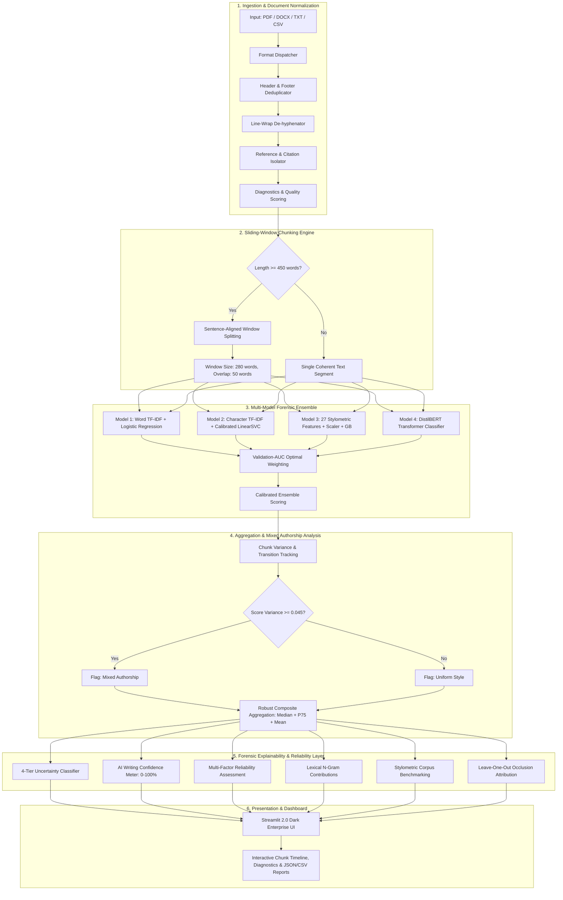

# VeriText 2.0: System Architecture Document
## Industrial-Grade AI-Generated Text Detection & Explainability System

**Document Version**: 2.0.0  
**Domain**: Natural Language Processing, Forensic Text Analysis & Machine Learning Operations  
**Date**: October 2026  

---

## 1. Architectural Overview

VeriText Version 2.0 is an enterprise-ready, explainable AI-text detection architecture designed to classify, inspect, and explain whether written content is human-authored, synthetic AI-generated, or hybrid mixed-authorship. Unlike brittle single-score detectors, VeriText operates as a multi-tier forensic pipeline combining lexical n-grams, sub-word character representations, stylometric syntactic distributions, and optional transformer embeddings.

---

## 2. Core Subsystems & Components

### 2.1 Ingestion & Document Preprocessing Subsystem (`src/file_input.py`)
Real-world documents present complex structural noise that corrupts standard NLP tokenizers. VeriText 2.0 implements five specialized cleaning layers:
1. **Format Dispatcher**: Handles native streams for `.pdf` (via `pypdf.PdfReader`), `.docx` (via `python-docx`), `.txt` (with UTF-8, Latin-1, and CP1252 fallbacks), and `.csv` (batch rows).
2. **Header & Footer Deduplicator**: Analyzes the first 3 lines and trailing 3 lines across all extracted pages. Lines occurring with a frequency $\ge 40\%$ across pages are identified as running publication titles or volume banners and stripped.
3. **Line-Wrap De-hyphenator**: Applies regex reconstruction `(\b\w+)-\s*[\r\n]+\s*(\w+\b) \rightarrow \1\2` to mend split vocabulary items.
4. **Reference Section Isolator**: Detects academic references (`REFERENCES [1]...`, `BIBLIOGRAPHY`, `WORKS CITED`). Citations are cataloged, counted for diagnostics, and decoupled from the essay body to prevent reference names from biasing classification.
5. **Extraction Quality Grading**: Calculates extraction density, blank pages, and issues forensic warnings (`HIGH`, `MEDIUM`, `LOW`, `POOR / OCR NEEDED`).

---

### 2.2 Sliding-Window Chunking Engine (`src/chunking.py`)
Traditional NLP detectors evaluate multi-page documents as single monolithic inputs, resulting in severe feature space distortion.
- **Window Size**: 280 words (aligned with standard student essay length).
- **Overlap**: 50 words (guarantees cross-boundary contextual continuity).
- **Sentence Boundary Preservation**: Splits occur strictly on sentence terminators (`.`, `!`, `?`), never cutting words or phrases mid-thought.
- **Mixed Authorship Detector**:
  $$\text{Var}(S) = \frac{1}{N} \sum_{i=1}^N (s_i - \bar{s})^2$$
  If $\text{Var}(S) \ge 0.045$ and both AI-dominated chunks ($s_i \ge 0.60$) and human-dominated chunks ($s_i \le 0.40$) exist, the document is categorized as **MIXED CHARACTERISTICS**.
- **Composite Aggregation Formula**:
  $$S_{\text{composite}} = 0.60 \cdot \text{Median}(S) + 0.25 \cdot P_{75}(S) + 0.15 \cdot \text{Mean}(S)$$
  This formulation prioritizes the median for outlier robustness while capturing localized AI text via the 75th percentile.

---

### 2.3 Feature Engineering Subsystem (`src/features.py`)
VeriText 2.0 constructs a 27-dimensional stylometric feature vector engineered specifically for authorial verification:
- **Lexical Diversity**: Type-Token Ratio ($\text{TTR} = \frac{|V|}{N}$), Hapax Legomena Ratio ($H = \frac{V_1}{|V|}$), Repetition Index.
- **Sentence Cadence & Burstiness**:
  $$\text{Burstiness} = \frac{\sigma_{\text{sent}}}{\max(1.0, \mu_{\text{sent}})}$$
  Human writing displays high burstiness ($\approx 0.60–0.85$); synthetic LLM text displays low burstiness ($\approx 0.35–0.50$).
- **Syntactic & Function Word Distributions**: Flesch Reading Ease score, stopword ratios, comma/semicolon densities, exclamation/question distributions.
- **Shannon Information Entropy**:
  $$H(X) = -\sum_{i} P(x_i) \log_2 P(x_i)$$
  Calculated across word tokens and sentence length frequencies.
- **Suspicious Pattern Detector**: Flags excessive formal transition markers ("moreover", "furthermore", "it is crucial to note", "delve into") per 1,000 words.

---

### 2.4 Multi-Model Classifier Pool (`models/`)
The detection engine employs an ensemble of heterogeneous classifiers, each addressing a distinct linguistic hypothesis:

| Model | Representation | Algorithm | Purpose |
|---|---|---|---|
| **Model 1: Word N-Gram** | Sublinear TF-IDF (1-2 words, 15,000 max features) | Balanced Logistic Regression ($C=3.0$) | Captures vocabulary selection, topic framing, and explicit phraseology. |
| **Model 2: Char N-Gram** | Character N-Grams (3-5 chars, 8,000 max features) | Calibrated LinearSVC (Sigmoid, $C=1.5$) | Captures sub-word morphology, punctuation rhythms, and spelling idiosyncrasies. |
| **Model 3: Stylometric** | 27 Engineered Structural Features + StandardScaler | Gradient Boosting Classifier ($120$ trees, depth 3) | Captures sentence length variation, readability, and syntactic burstiness. |
| **Model 4: Transformer** | DistilBERT-base-uncased contextual embeddings | Fine-tuned PyTorch Sequence Classifier | Captures deep semantic representations and contextual dependencies. |

---

### 2.5 Calibrated Ensemble Formulation (`src/ensemble.py`)
Ensemble weights are derived exclusively from held-out validation data using validation ROC-AUC:
$$w_m = \frac{\max(0.01, \text{AUC}_m - 0.5)}{\sum_j \max(0.01, \text{AUC}_j - 0.5)}$$
Final probability is computed as:
$$P(\text{AI} \mid x) = \sum_{m=1}^M w_m \cdot P_m(\text{AI} \mid x)$$
The decision threshold is optimized on validation F1-score across $[0.30, 0.70]$ to minimize false positives.

---

### 2.6 Multi-Factor Reliability & Explainability (`src/reliability.py`, `src/explainability.py`)
Rather than outputting a raw uncalibrated number, the system contextualizes every prediction:
1. **Multi-Factor Reliability Assessment**:
   - Assesses text length density ($<50$ words $\rightarrow$ Insufficient).
   - Evaluates cross-model standard deviation ($\sigma_{\text{models}} \ge 0.28 \rightarrow$ Divergent penalty).
   - Measures proximity to the decision threshold.
   - Outputs: `High Reliability`, `Medium Reliability`, `Low Reliability`, `Insufficient Text`.
2. **Local Feature Occlusion Attribution**:
   $$\Delta_f = P(\text{AI} \mid x) - P(\text{AI} \mid x_{[f \leftarrow \text{median}_f]})$$
   Replaces each feature with its training corpus median to quantify its exact contribution to the decision.
3. **Empirical Benchmarking**: Directly compares the document's burstiness, lexical diversity, and sentence lengths against established corpus averages for Human vs. AI text.
